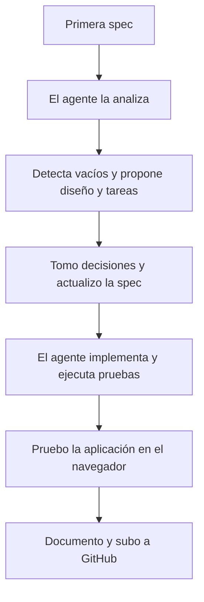

# Explorando Antigravity: gestor de tareas con calendario

## Presentación
Este proyecto explora **Antigravity IDE**, un entorno de desarrollo asistido por IA, para analizar en qué etapas del desarrollo de software ayuda y qué sigue dependiendo de la persona.

Para probarlo construí un **gestor de tareas con calendario semanal**, aplicando *Spec-Driven Development*: primero describí qué quería, el agente analizó esa descripción y, con las reglas aclaradas, implementó la solución.

## La aplicación
Permite crear, actualizar, borrar y completar tareas, agendarlas por bloques horarios y verlas en un calendario semanal. Valida que el tiempo disponible alcance para la tarea y que dos tareas pendientes no se crucen.

**Tecnologías:** HTML, CSS y JavaScript sin frameworks, con datos guardados en `localStorage`.

## Flujo de trabajo


## Evolución de la especificación

### 1. Primera versión
Describía la idea, las funciones principales, dos restricciones y un solo caso de prueba. 

### 2. Respuesta del agente
Le pedí revisar la spec y proponer diseño y tareas antes de programar.

### 3. Nueva versión
Con apoyo de otro asistente de IA (Claude) redacté la nueva versión, a partir de las preguntas del agente.

| Tema | Primera versión | Nueva versión |
|---|---|---|
| Tecnología | Sin definir | HTML, CSS y JavaScript |
| Datos | Sin definir | `localStorage`, un usuario |
| Horario | "El tiempo que tengo" | Fecha, hora de inicio y fin |
| Tiempo disponible | Mayor al estimado | Mayor o igual al estimado |
| Tareas seguidas | Sin definir | Son válidas |
| Tarea completada | Sin definir | Libera su horario |
| Calendario | Sin detalle | Vista semanal |
| Casos de prueba | 1 | 12 |


## Pruebas
El agente reportó **13 de 13 pruebas aprobadas** en consola (`gjs`): los 12 casos de la spec y uno adicional sobre persistencia y fechas inválidas.

Esas pruebas cubren la lógica de negocio con almacenamiento en memoria. El agente aclaró que **no pudo verificar la interfaz en el navegador**, así que esa revisión fue manual. En ella comprobé que una tarea cruzada con otra muestra un error.

## Cómo ejecutarlo
```bash
python3 -m http.server 8000
```
- Aplicación: http://localhost:8000/index.html
- Pruebas en el navegador: http://localhost:8000/tests.html
- Pruebas en consola (requiere `gjs`): `gjs tests/run_gjs.js`

## ¿En qué etapas ayudó?
| Etapa | Cómo ayudó Antigravity | Qué hice yo |
|---|---|---|
| Requisitos | Detectó ambigüedades y casos faltantes | Decidir las reglas |
| Diseño | Propuso separar datos, lógica, persistencia e interfaz | Aprobar el enfoque |
| Código | Generó la aplicación en pocos minutos | Revisar los cambios |
| Pruebas | Creó y ejecutó las pruebas de lógica | Probar la interfaz |
| Documentación | Generó instrucciones de ejecución | Completar y editar el README |

## Observaciones y mejoras pendientes
- En el calendario, los botones de una tarea de 60 minutos se ven recortados.
- _Anota aquí otros detalles que encuentres al probar._

## Conclusiones
Antigravity aceleró sobre todo la implementación y las pruebas. La calidad del resultado dependió de aclarar antes las reglas, y la revisión humana siguió siendo necesaria porque la interfaz no se verificó automáticamente.

No había probado una herramienta tan veloz de hecho complementandolo con otros asistentes de IA, es aún más rápido, en mi proyectos personales me demoraba mucho, ya que programar no es un proceso ágil
hecho por el humano también analice lo necesario que es el impacto humano y la verificación de lo que genera la IA, especificando arquitecturas, tecnólogias y demás requerimientos, apesar de la velocidad
también esta el riesgo de desentenderse del proyecto darle toda la responsabilidad al agente, la importancia de la ingeniería toma más peso en estos procesos y no hacer las cosas únicamente por hacerlas.

A continuación voy a presentar mi primer archivo spec:

# Un gestor de tareaaaaaaaaas
 - Hagamos un gestor de tareas que nos permita añadir tareas, completarlas y borrarlas. Con un calendario que se agende el  - tiempo para realizar las tareas que tengamos pendientes. 
# ¿Que vamos a hacer?
- Desarrollar un software con una interfaz interactiva que me permita registrar mis tareas, el tiempo que tengo para hacerlas, el tiempo que me lleva hacerlas y que me muestre un calendario con las tareas que tengo pendientes.
# Funciones
- Crear una tarea, borrarla, actualizarla y marcarla como completada.
- Mostrar un calendario con las tareas que tengo pendientes y el tiempo que tengo para hacerlas.
# Restricciones
- El tiempo que tengo para hacer las tareas debe ser mayor al tiempo que me lleva hacerlas. 
- No se puedan sobre escribir tareas en un mismo horario.
# Casos de prueba 
- Crear una tarea sin tiempo, mostrar error

Muy general, por lo que la respuesta del agente analizando mis requisitos es totalmente clave, ya que si se hubiera especificado eso hubiera empezado a desarrollar se hubiera salido de mis manos y todo lo escogería.
En esta carpeta se encuentra un pantallazo con el proyecto que se realizo y el spec final después de la retroalimentación del agente.

