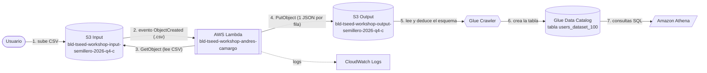
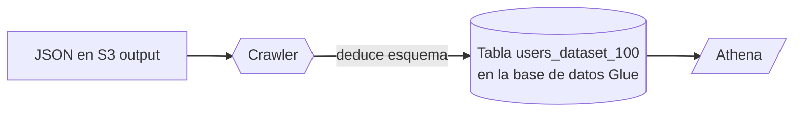
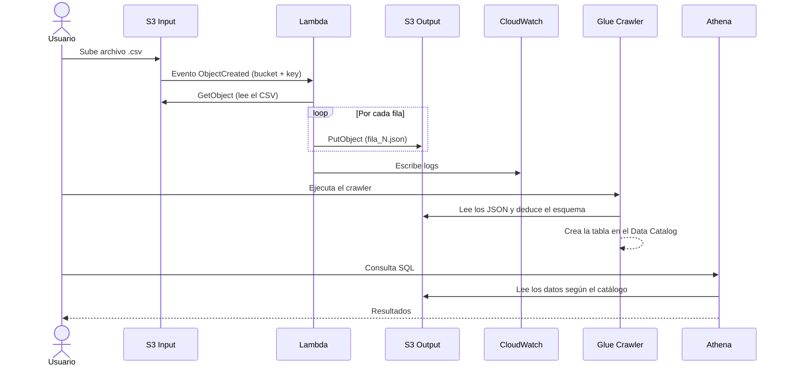

# The Twelve-Factor App — Selección y justificación

**Fecha:** 20 de noviembre del 2026

---

## Factores seleccionados

1. **III. Config** — Configuración en variables de entorno.
2. **IV. Backing services** — Servicios externos tratados como recursos adjuntos.
3. **II. Dependencies** — Dependencias declaradas y aisladas explícitamente.
4. **XI. Logs** — Logs como flujos de eventos.

---

## Justificación

Considero que los siguientes elementos son los que más presentes han estado a lo largo de las actividades realizadas: **Config**, **Backing services**, **Dependencies** y **Logs** porque son los factores que atraviesan varios de las actividades que se han desarrollado por dar unos ejemplos: la integración con Teams para reportes de daily scrum, la analítica con OpenSearch desplegada en Docker y el pipeline serverless en AWS con S3, Lambda, Glue y Athena— y porque atacan directamente los puntos donde más riesgo operativo y más fricción de entrega hemos identificado. **Config** nos permite separar credenciales y parámetros de entorno del código, reduciendo el riesgo de filtraciones y facilitando el despliegue en distintos contextos. **Backing services** nos obliga a tratar software (Teams, OpenSearch y los servicios de AWS) como recursos conectados por configuración, de modo que podamos reemplazarlos o escalarlos sin tocar la lógica de negocio, lo que es clave para la portabilidad que un cliente espera. **Dependencies** garantiza que cualquier miembro del equipo o del cliente pueda levantar el proyecto con Docker o empaquetar una Lambda con sus librerías exactas, eliminando la variabilidad entre entornos. Finalmente, **Logs** nos asegura que los eventos de la aplicación y del pipeline fluyan como streams hacia CloudWatch u OpenSearch, habilitando la observabilidad y la depuración en un sistema distribuido. En conjunto, estos cuatro factores no solo son buenas prácticas técnicas: son la base para que el cliente perciba entregas repetibles, auditables y con menor tiempo de inactividad.

---

## Valor para el cliente

- **Config** → menos riesgo de incidentes de seguridad y menor tiempo para habilitar un nuevo entorno.
- **Backing services** → capacidad de adaptarse a la infraestructura del cliente sin rehacer el proyecto.
- **Dependencies** → entregas reproducibles que el equipo del cliente puede ejecutar sin configuraciones manuales.
- **Logs** → trazabilidad y auditoría, requisito directo en reportes de daily scrum y en pipelines de datos.

# Assignment 2 – Modelado arquitectónico C4: Control de Dailies en MS Teams

**Escenario:** Acme Corp
**Sistema propuesto:** Daily Standup Controller

---

## 1. Objetivo

Modelar con los tres primeros niveles del C4 Model (Contexto, Contenedores y Componentes) una solución integrada con Microsoft Teams que permita a Acme Corp llevar un control estructurado de los reportes diarios de sus equipos Scrum:

1. Enviar notificaciones programadas a cada integrante a una hora definida.
2. Recibir el reporte diario en casillas predefinidas.
3. Validar quién no realizó el reporte.
4. Detectar si una persona reporta la misma temática tres veces consecutivas.
5. Publicar los reportes en un canal de Teams visible para el grupo.

## 2. Preliminar: lo que entendí de cada nivel del C4

Es la primera vez que construyo un C4 Model. Esto fue lo que entendí:

- **C1 – Contexto:** muestra el sistema como una única caja, rodeada de las personas que lo usan y de los sistemas externos con los que se relaciona. No incluye tecnologías. Responde a: ¿qué es el sistema y quién interactúa con él?
- **C2 – Contenedores:** abre la caja del sistema y muestra sus piezas desplegables o ejecutables por separado (una API, una función programada, una base de datos), junto con la tecnología de cada una y los protocolos con que se comunican. Responde a: *¿de qué piezas grandes está hecho y cómo se hablan?*
- **C3 – Componentes:** hace zoom en un solo contenedor y muestra sus módulos internos, cada uno con una responsabilidad clara. Responde a: *¿cómo está organizado por dentro el contenedor más importante?*

Cada nivel es un zoom del anterior, por lo que lo que aparece en uno debe poder rastrearse en el siguiente.

## 3. Diagramas

| Nivel | Contenido |
|---|---|
| C1 – Contexto | Developer, Scrum Master, Daily Standup Controller y Microsoft Teams |
| C2 – Contenedores | Daily Bot API, Daily Scheduler y Daily Database |
| C3 – Componentes | 7 componentes del contenedor Daily Bot API |


## 4. Lógica de estructuración del sistema

Partí de una idea: Teams ya es la interfaz que usa el equipo, por lo que no construí ninguna aplicación de cara al usuario. El sistema es un bot que vive "detrás" de Teams. En C1 dejé solo dos actores, el Developer (quien reporta) y el Scrum Master (quien facilita el daily y remueve impedimentos), y a Teams como único sistema externo. Dejé fuera al Product Owner porque el no interviene en el control del daily y Teams ya entrega la identidad del usuario con cada mensaje.

En C2 mapeé cada requisito a una responsabilidad. Concentré la lógica de negocio en un único contenedor (*Daily Bot API*), separé lo que depende del tiempo en un *Daily Scheduler* que solo "dispara" y no decide nada, y dejé la persistencia en una base de datos relacional. En C3 organicé la API por responsabilidad: dos puertas de entrada (Teams y Scheduler), servicios de lógica (reporte, seguimiento diario y detección de estancamiento) y dos componentes de salida que aíslan lo externo: el *Teams Notifier* (todo lo que sale hacia Teams) y el *Report Repository* (todo lo que va a la base de datos). Así, un cambio de canal o de base de datos afecta a un solo componente.

## 5. Decisiones y justificaciones

### 5.1 Alcance (C1)
- **Developer y Scrum Master:** en Scrum, los Developers se autoorganizan y toman el trabajo del backlog; el Product Owner ordena el Product Backlog y el Scrum Master facilita y remueve impedimentos. Por eso el Scrum Master recibe las alertas de ausencia y de estancamiento.
- **Quién ejecuta las validaciones:** las validaciones, la detección y la publicación (requisitos 3, 4 y 5) las hace el **sistema**, no una persona. Las personas reportan, reciben alertas o leen.

### 5.2 Contenedores (C2)
- **Las personas interactúan a través de Teams.** En C2 las flechas de las personas apuntan a Teams porque es la interfaz real que usan; el sistema las atiende detrás.
- **El Scheduler solo dispara.** Llama a la API en lugar de validar él mismo, para que las reglas de negocio vivan en un único lugar y no se dupliquen.

### 5.3 Componentes (C3)
- **Notifier y Repository como únicos puntos de salida:** facilitan cambiar de canal de mensajería o de base de datos.
- **Un solo Follow-up Service** para recordatorios y revisión de ausencias, porque ambos son tareas por horario sobre los mismos datos.
- **Stagnation Detector separado:** la regla de las 3 repeticiones es la más delicada y conviene poder cambiarla sin tocar el resto. Como Lambda no conserva estado entre ejecuciones, el detector consulta siempre los últimos 3 reportes en la base de datos.

**PostgreSQL:** los datos son tabulares y relacionados (equipos → miembros → reportes por fecha), y la consulta de los "últimos 3 reportes" es directa en SQL.

### 5.4 Bot Framework y su relación con la nube elegida
- **Bot Framework SDK:** biblioteca de Microsoft (disponible en Node.js) con la que se escribe el bot. Corre dentro de nuestro código, en la API.
- **Bot Framework Connector:** servicio/API de Microsoft a través de la cual el bot recibe y envía mensajes a canales como Teams.
- **Registro del bot:** aunque el código se ejecute en AWS, el bot debe registrarse del lado de Microsoft (recurso de bot y registro de aplicación) para que Teams pueda enviarle mensajes. 

## 6. Cobertura de los requisitos

| # | Requisito | Quién lo resuelve |
|---|---|---|
| 1 | Notificaciones programadas | Daily Scheduler → Scheduler Controller → Daily Follow-up Service → Teams Notifier |
| 2 | Reporte en casillas predefinidas | Teams Notifier (envía el formulario) y Teams Activity Handler + Report Service (lo reciben y guardan) |
| 3 | Validar quién no reportó | Daily Scheduler → Daily Follow-up Service → Teams Notifier (alerta al Scrum Master) |
| 4 | Detectar mismo tema 3 veces seguidas | Report Service → Stagnation Detector → Teams Notifier |
| 5 | Publicar reportes en un canal | Report Service → Teams Notifier |


# Pipeline de datos serverless en AWS: CSV → JSON → Glue → Athena

| | |
|---|---|
| **Autor** | Andrés Camargo |
| **Fecha** | 17 de noviembre de 2026 |
| **Región AWS** | US East (N. Virginia) `us-east-1` |
| **Servicios** | Amazon S3 · AWS Lambda · AWS IAM · Amazon CloudWatch · AWS Glue · Amazon Athena |
| **Lenguajes** | Python 3 (Lambda) · SQL (Athena) |

---

## 1. Objetivo

Construir un pipeline de datos orientado a eventos que:

1. Reciba un archivo **CSV** en un bucket de entrada (*input*).
2. Lo transforme automáticamente con una función **Lambda** en Python, generando **un archivo JSON por cada fila**.
3. Deje los JSON en un bucket de salida (*output*).
4. Catalogue esos JSON en una base de datos de **AWS Glue** mediante un *crawler*.
5. Permita consultarlos con **SQL** desde **Amazon Athena**.

---

## 2. Arquitectura



**Tipo de patrón:** ETL (*Extract, Transform, Load*) serverless, disparado por eventos.

| Fase ETL | Dónde ocurre |
|---|---|
| **Extract** | La Lambda lee el CSV del bucket input (`get_object`) |
| **Transform** | `csv.DictReader` convierte cada fila en diccionario y `json.dumps` en JSON |
| **Load** | La Lambda escribe cada JSON en el bucket output (`put_object`); luego Glue los cataloga |

---

## 3. Servicios de AWS utilizados

| Servicio | Rol en el proyecto | Concepto clave |
|---|---|---|
| **Amazon S3** | Almacena el CSV (input) y los JSON (output) | Almacenamiento de objetos. Las "carpetas" no existen: son parte del nombre (*key*) del objeto, p. ej. `AndresCamargo/archivo.csv` |
| **AWS Lambda** | Ejecuta el código Python que transforma los datos | Cómputo sin servidor; se paga por ejecución; tiene timeout y memoria configurables |
| **Notificaciones de S3 (trigger)** | Conecta el bucket input con la Lambda | Arquitectura orientada a eventos |
| **AWS IAM** | Define qué puede hacer cada servicio | Roles, políticas y principio de mínimo privilegio |
| **Amazon CloudWatch** | Registra logs de la Lambda | Herramienta principal de depuración |
| **AWS Glue** | Base de datos (Data Catalog) y *crawler* | El catálogo solo guarda **metadatos**; los datos siguen en S3 |
| **Amazon Athena** | Consultas SQL sobre los datos en S3 | Motor de consultas sin servidor; guarda los resultados en S3 |

---

## 4. Desarrollo paso a paso

### 4.1 Creación de los buckets

Se crearon dos buckets en S3, con una carpeta `AndresCamargo/` dentro de ellos:

| Bucket | Función |
|---|---|
| `bld-tseed-workshop-input-semillero-2026-q4-c` | Recibe el archivo CSV |
| `bld-tseed-workshop-output-semillero-2026-q4-c` | Recibe los JSON generados |

> **Por qué dos buckets distintos:** si la Lambda escribiera en el mismo bucket que la dispara, se invocaría a sí misma en un bucle infinito (con el consiguiente costo).


### 4.2 Función Lambda

Función: `bld-tseed-workshop-andres-camargo` (Python 3).

**Lógica:**

1. S3 dispara la Lambda y le entrega un `event` con el bucket y la *key* del archivo.
2. La Lambda descarga el CSV con `boto3`.
3. `csv.DictReader` usa la primera fila como encabezado y devuelve cada fila como diccionario.
4. Cada diccionario se serializa a JSON y se guarda como un objeto independiente en el output.

**Código final:**

```python
import csv
import io
import json
import urllib.parse

import boto3

s3 = boto3.client('s3')

OUTPUT_BUCKET = 'bld-tseed-workshop-output-semillero-2026-q4-c'


def lambda_handler(event, context):
    total_filas = 0

    # Un evento de S3 puede traer uno o varios registros
    for record in event['Records']:
        bucket = record['s3']['bucket']['name']
        # La key viene codificada en URL (espacios -> '+'), por eso se decodifica
        key = urllib.parse.unquote_plus(record['s3']['object']['key'])

        # 1. Leer el CSV desde el bucket input
        respuesta = s3.get_object(Bucket=bucket, Key=key)
        contenido = respuesta['Body'].read().decode('utf-8-sig')  # quita el BOM de Excel

        # 2. Convertir cada fila en un diccionario
        lector = csv.DictReader(io.StringIO(contenido))
        nombre_base = key.rsplit('.', 1)[0]

        # 3. Guardar cada fila como un JSON en el bucket output
        for i, fila in enumerate(lector, start=1):
            s3.put_object(
                Bucket=OUTPUT_BUCKET,
                Key=f"{nombre_base}/fila_{i}.json",
                Body=json.dumps(fila, ensure_ascii=False),
                ContentType='application/json'
            )
            total_filas += 1

    return {
        'statusCode': 200,
        'body': json.dumps(f'{total_filas} filas convertidas a JSON')
    }
```

| Elemento del código | Para qué sirve |
|---|---|
| `event['Records']` | Lista de eventos que envía S3 |
| `unquote_plus` | Decodifica la *key* (S3 la entrega codificada en URL) |
| `utf-8-sig` | Evita que el BOM de los CSV exportados desde Excel contamine el primer encabezado |
| `csv.DictReader` | Entrega cada fila con los nombres de columna como llaves, que es justo la forma de un JSON |
| `ensure_ascii=False` | Conserva tildes y caracteres especiales |
| `nombre_base/fila_N.json` | Ruta de salida: una carpeta por CSV y un archivo por fila |


### 4.3 Rol de ejecución y permisos (primera configuración)

Al crear la Lambda se generó un rol de ejecución (`bld-tseed-workshop-andres-camargo-role-dqxholhy`) que por defecto incluye solo `AWSLambdaBasicExecutionRole`, que permite únicamente escribir logs en CloudWatch. Se le agregó una **política adicional** con permisos sobre S3:

```json
{
  "Version": "2012-10-17",
  "Statement": [
    {
      "Effect": "Allow",
      "Action": "s3:GetObject",
      "Resource": "arn:aws:s3:::bld-tseed-workshop-input-semillero-2026-q4-c/*"
    },
    {
      "Effect": "Allow",
      "Action": "s3:PutObject",
      "Resource": "arn:aws:s3:::bld-tseed-workshop-output-semillero-2026-q4-c/*"
    }
  ]
}
```

El **Resumen de recursos** (Configuración → Permisos) confirmó el permiso: `Amazon S3 – 2 acciones, 2 recursos` (`GetObject` sobre el input y `PutObject` sobre el output).

#### Dos tipos de política distintos (confusión inicial)

Durante la configuración apareció una pantalla que pedía un `Principal`. Se identificó que existen dos tipos de política y que no se deben mezclar:

| | Política **basada en identidad** | Política **basada en recursos** |
|---|---|---|
| **Pregunta que responde** | ¿Qué puede **hacer** esta Lambda? | ¿Quién puede **invocar** esta Lambda? |
| **Dónde vive** | En el **rol** de ejecución (IAM) | En la propia Lambda (Configuración → Permisos) |
| **Lleva `Principal`** | No | Sí |
| **Ejemplo en este proyecto** | `GetObject`, `ListBucket`, `PutObject` sobre S3 | Permiso para que `s3.amazonaws.com` ejecute `lambda:InvokeFunction` |
| **Quién la crea** | Nosotros, en IAM | La crea **automáticamente** el trigger de S3 |

### 4.4 Configuración del trigger (desencadenador)

Lambda → **Agregar desencadenador** → origen **S3**:

| Parámetro | Valor |
|---|---|
| Bucket | `bld-tseed-workshop-input-semillero-2026-q4-c` |
| Tipo de evento | Todos los eventos de creación de objetos |
| Sufijo (recomendado) | `.csv` |

AWS confirmó con el mensaje *"El desencadenador … se agregó correctamente a la función"*, y el diagrama de la Lambda muestra S3 conectado a la izquierda. Al crearlo, AWS agregó solo, en la política basada en recursos, el permiso `lambda:InvokeFunction` para S3 con condiciones de cuenta y de bucket de origen.

### 4.5 Pruebas y depuración de la Lambda


Evento de prueba (`Unit-test`) que simula lo que envía S3:

```json
{
  "Records": [
    {
      "s3": {
        "bucket": { "name": "bld-tseed-workshop-input-semillero-2026-q4-c" },
        "object": { "key": "AndresCamargo/NOMBRE-DEL-ARCHIVO.csv" }
      }
    }
  ]
}
```


### 4.6 AWS Glue: base de datos y crawler

Los JSON están en S3, pero AWS no conoce su estructura. Para exponerlos como tabla se usaron dos componentes de Glue:

- **Base de datos (Data Catalog):** contenedor lógico de metadatos.
- **Crawler:** lee los archivos, deduce columnas y tipos, y **crea la tabla**.



| Elemento | Valor |
|---|---|
| Base de datos | `bld-tseed-workshop-andres-camargo` |
| Crawler | `bld-tseed-workshop-crawlers-Andres-camargo` |
| Origen de datos | Carpeta del bucket output con los JSON (`s3://bld-tseed-workshop-output-semillero-2026-q4-c/...`) |
| Ejecución | *On demand* |
| Tabla generada | `users_dataset_100` |

**Columnas detectadas** (todas de tipo `string`): `user_id`, `name`, `country`, `city`, `role`, `department`, `education`, `age`, `gender`, `marital_status`, `experience_years`, `skills`, `languages`, `hobbies`, `salary`, `email`, entre otras.

> **Hallazgo:** todas las columnas quedaron como `string`, incluso `age` y `salary`, porque `csv.DictReader` lee todos los valores como texto y la Lambda los escribió así en el JSON. Por eso, en Athena hay que usar `CAST` para comparar o calcular con números.


### 4.7 Amazon Athena: consultas SQL

Athena consulta directamente los JSON en S3 usando el esquema de la tabla del catálogo. Antes de la primera consulta fue necesario configurar dónde guardar los resultados 

---

## 5. Cambios de permisos realizados

Los permisos no funcionaron a la primera; se fueron ajustando según los errores. Resumen de cada cambio:

| # | Dónde | Cambio | Por qué fue necesario |
|---|---|---|---|
| 1 | Rol de la Lambda (IAM) | Se agregó `s3:GetObject` (input) y `s3:PutObject` (output) | Por defecto el rol solo podía escribir logs; sin esto la Lambda no puede leer ni escribir en S3 |
| 2 | Rol de la Lambda (IAM) | Se agregó `s3:ListBucket` sobre el bucket input (**sin** `/*`) | Sin este permiso, cuando un objeto no existe S3 responde `AccessDenied` en lugar de `NoSuchKey`, ocultando la causa real del error |
| 3 | Política de la Lambda (basada en recursos) | Se agregó automáticamente `lambda:InvokeFunction` para `s3.amazonaws.com` | Lo crea el trigger; permite que S3 invoque la función |
| 4 | Rol del crawler de Glue (IAM) | Se asignó un rol de servicio válido para Glue con lectura del bucket output | El primer intento falló por un rol inexistente (ver sección 6) |
| 5 | Athena (configuración del workgroup) | Se definió la ubicación de resultados de consultas | Athena exige un destino en S3 antes de ejecutar la primera consulta |

**Política final del rol de la Lambda:**

```json
{
  "Version": "2012-10-17",
  "Statement": [
    {
      "Effect": "Allow",
      "Action": "s3:GetObject",
      "Resource": "arn:aws:s3:::bld-tseed-workshop-input-semillero-2026-q4-c/*"
    },
    {
      "Effect": "Allow",
      "Action": "s3:ListBucket",
      "Resource": "arn:aws:s3:::bld-tseed-workshop-input-semillero-2026-q4-c"
    },
    {
      "Effect": "Allow",
      "Action": "s3:PutObject",
      "Resource": "arn:aws:s3:::bld-tseed-workshop-output-semillero-2026-q4-c/*"
    }
  ]
}
```

> **Detalle de sintaxis que se identificó:** `GetObject` y `PutObject` actúan sobre *objetos* y por eso el recurso termina en `/*`; `ListBucket` actúa sobre el *bucket* y por eso el recurso **no** lleva `/*`.

---

## 6. Errores encontrados, causa y solución

| # | Error | Dónde | Causa real | Solución |
|---|---|---|---|---|
| 1 | `KeyError: 'Records'` | Lambda, botón *Test* | El evento de prueba por defecto no tiene el formato de S3 y el código espera `event['Records']` | Crear un evento de prueba con la estructura de S3 (sección 4.5). La subida real de un CSV sí envía `Records` |
| 2 | `AccessDenied` al llamar `GetObject` (*no autorizado para `s3:ListBucket`*) | Lambda | Faltaba `s3:ListBucket` en el rol y, además, la *key* del evento de prueba no coincidía con un archivo existente. Con el permiso ausente, S3 oculta la inexistencia del objeto | Agregar `s3:ListBucket` al rol |
| 3 | `NoSuchKey: The specified key does not exist` | Lambda | La *key* del evento de prueba no incluía la "carpeta" `AndresCamargo/`. En S3 la ruta completa forma parte del nombre del objeto | Usar la *key* completa: `AndresCamargo/archivo.csv` |
| 4 | `Task timed out after 3.00 seconds` | Lambda | El timeout por defecto (3 s) no alcanza: el código hace un `put_object` por fila, en serie, más el tiempo de arranque. **Los JSON sí aparecieron en el output**, lo que confirma que la lógica y los permisos eran correctos | Aumentar el timeout (Configuración → Configuración general → Editar; p. ej. 1 minuto), re-ejecutar y verificar que el número de JSON coincida con las filas del CSV |
| 5 | Pantalla que exigía `Principal` | IAM / Lambda | Se intentó pegar una política de identidad en la pantalla de la política basada en recursos | Editar la política en el **rol** (IAM), no en la política de la Lambda |
| 6 | `AccessDeniedException … unable to assume the role …/AWSGlueServiceRole-` | Glue, creación del crawler | El nombre del rol quedó incompleto (terminaba en guion), por lo que el rol no existía y Glue no pudo asumirlo. El mensaje sugería "habilitar STS", pero **STS no era el problema** | Seleccionar o crear un rol válido para Glue con permiso de lectura sobre el bucket output |
| 7 | `No output location provided` | Athena | Athena guarda cada resultado en S3 y no había ubicación configurada | Editar ajustes → configurar *Athena managed query results* o un bucket/carpeta de resultados |
| 8 | Consulta apuntaba a un nombre de base de datos mal escrito y a `age` como si fuera una tabla | Athena | Se mezclaron nombres; `age` es una **columna**, no una tabla | Seleccionar la base en el panel y consultar `users_dataset_100` |
| 9 | `Only one sql statement is allowed` | Athena | Un `;` al final de la primera línea cerró la sentencia y `WHERE …` quedó como una segunda | El `;` va una sola vez, al final de toda la consulta |

---

## 7. Flujo temporal de una ejecución



---

## 8. Consultas SQL practicadas en Athena

Tabla: `users_dataset_100`. Todas las columnas son `string`, por lo que se usa `CAST` para comparaciones numéricas.

| # | Pregunta | Consulta |
|---|---|---|
| 1 | Personas que hablan inglés y tienen más de 35 años | `SELECT * FROM users_dataset_100 WHERE languages LIKE '%English%' AND CAST(age AS INTEGER) > 35;` |
| 2 | Personas que viven en Berlín y tienen estudios *Bachelor's* | `SELECT * FROM users_dataset_100 WHERE city = 'Berlin' AND education = 'Bachelor''s';` |
| 3 | Data Analysts con más de 20 años | `SELECT * FROM users_dataset_100 WHERE role = 'Data Analyst' AND CAST(age AS INTEGER) > 20;` |
| 4 | Quienes ganan más (salario máximo) | Ver abajo |
| 5 | Top 5 de salarios | Ver abajo |

**Consulta 4: subconsulta con `MAX`:**

```sql
SELECT *
FROM users_dataset_100
WHERE CAST(salary AS DOUBLE) = (
    SELECT MAX(CAST(salary AS DOUBLE))
    FROM users_dataset_100
);
```

**Consulta 5: ranking con `ORDER BY` y `LIMIT`:**

```sql
SELECT name, role, country, salary
FROM users_dataset_100
ORDER BY CAST(salary AS DOUBLE) DESC
LIMIT 5;
```

**Conceptos de SQL aplicados:**

| Concepto | Uso |
|---|---|
| `SELECT … FROM … WHERE` | Estructura básica de filtrado |
| `AND` / `OR` | Combinar condiciones (en lugar de `&&` / `\|\|`) |
| `=` | Comparación de igualdad (un solo signo) |
| `LIKE '%texto%'` | Búsqueda parcial en campos con varios valores (p. ej. `languages`) |
| `CAST(col AS tipo)` | Convertir texto a número para comparar o calcular |
| Comilla doble `''` | Escapar un apóstrofe dentro de un texto (`'Bachelor''s'`) |
| Subconsulta | Calcular un valor (p. ej. el máximo) para usarlo en el `WHERE` |Spanish
| `ORDER BY … DESC` + `LIMIT` | Ranking de los N primeros |

---

## 9. Hallazgos y lecciones aprendidas

1. **Los permisos se definen de forma explícita.** Por defecto una Lambda no puede tocar S3; hay que concederlo en su rol.
2. **Identidad vs. recurso.** Lo que la Lambda *puede hacer* va en su rol (IAM). Quién *puede invocarla* va en su política basada en recursos, que el trigger crea solo.
3. **`ListBucket` aclara los errores.** Sin ese permiso, S3 responde `AccessDenied` aunque el problema real sea que el archivo no existe. Con él, el error es el claro `NoSuchKey`.
4. **En S3 no hay carpetas reales.** La ruta forma parte de la *key*, y por eso el evento de prueba debía incluir `AndresCamargo/`.
5. **El botón *Test* no simula a S3 por defecto.** Una Lambda depende del formato exacto del evento que recibe.
6. **Un timeout no implica fallo lógico.** Los JSON se generaron aunque la ejecución se cortó a los 3 s; conviene verificar el conteo de filas contra el de archivos.
7. **Glue no almacena datos.** El Data Catalog guarda metadatos; los datos permanecen en S3.
8. **Los tipos se heredan del origen.** Como el CSV se leyó como texto, el JSON y la tabla tienen todo en `string`.
9. **Los mensajes de error pueden engañar.** El error de Glue sugería habilitar STS, pero la causa era un nombre de rol incompleto.
10. **Mínimo privilegio.** Cada rol recibió solo lo necesario: leer el input, escribir el output, y (Glue) leer el output.

**Propiedades del diseño:**

- **Idempotencia:** volver a procesar el mismo CSV sobrescribe los mismos JSON, sin duplicar.
- **Desacoplamiento:** quien sube el CSV no conoce la Lambda; el trigger conecta las piezas.
- **Escalabilidad:** al ser serverless, no hay servidores que administrar.

---
